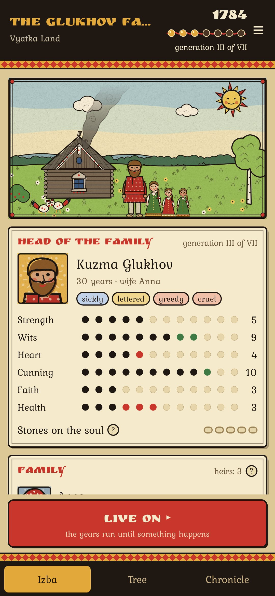
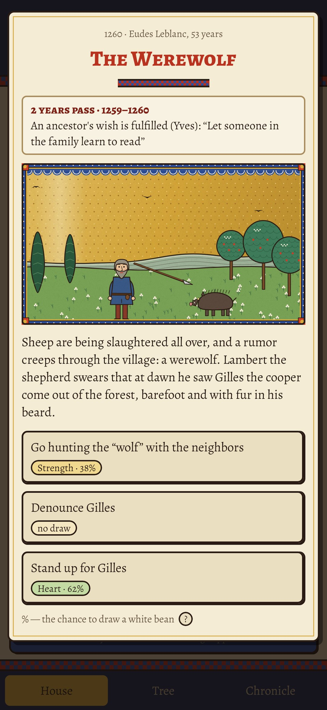
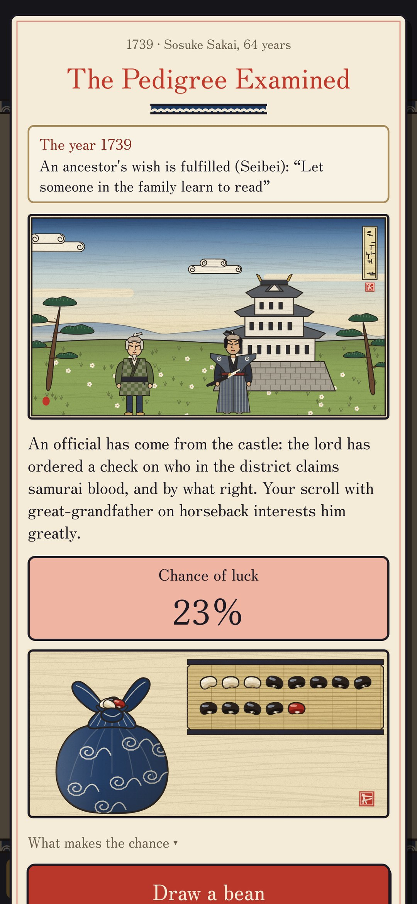
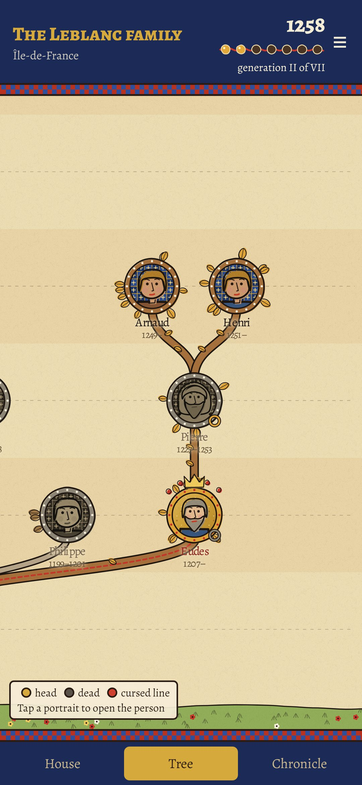
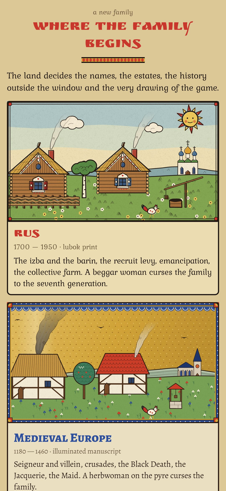

<div align="center">


# Seventh Generation

### Your family is cursed to the seventh generation. Carry the blood that far.

*A dynasty game told as a folk tale. A beggar woman in Rus, a herbwoman on the pyre in medieval France or a white fox at a Japanese shrine curses your founder's family. Every year may bring an event, and every deed is settled by a bean drawn from a bag: white is luck, black is misfortune, red is the curse. Children are born with blood traits and grow into tempers; when the head of the family dies you choose which descendant to play next. Reach the seventh generation and the curse is lifted; if the last of the line dies childless, the family ends. Free, no ads, no account, no internet.*

[](https://github.com/bigdevwhale/seventh/actions/workflows/android.yml)


[](LICENSE)

**English** · [Русский](README.ru.md) · [Changelog](CHANGELOG.md)

    

</div>

---

## How it works

1. **Choose a land.** Rus, 1690–1950, drawn as a lubok folk print. Medieval Europe, 1180–1460, an illuminated manuscript. Japan, 1662–1950, an ukiyo-e woodblock print. Each has its own names, estates, rival family, money, history and curse.
2. **Live on.** The years run until something happens: a bear by the village, a fire, a matchmaker with three candidates, a recruit levy, the Black Death, the daimyo's procession, the Black Ships. Each land has 75–84 everyday events and 18–22 from real history.
3. **Draw a bean.** Every risky choice shows its chance. The higher the stat it needs (strength, wits, heart, cunning, faith, health), the more white beans in the bag; traits, relics and the family legacy add more. One red bean always waits while the curse holds.
4. **Temper and the soul.** Children grow into tempers: kind or cruel, brave or cowardly, honest or lying. Acting against your temper lays a stone on the soul; five stones and something breaks.
5. **Consequences come back.** A soldier you hid returns as a bandit or a benefactor, stolen grain surfaces in court, a foundling grows up, a debt comes due years later. A family can leave the plough for a trade, a craft, a guild or a temple, and then lives a different life.
6. **Succession.** When the head dies, play any living descendant. Pass over the eldest son and he bears a grudge. The dead leave a last wish; fulfil it for glory, ignore it and they come in dreams.
7. **The tree and the chronicle.** The whole bloodline in medallions, the red thread of the cursed line through it, and every year written down.

Everything is drawn in code, in each land's own style. The game is in English and Russian.

## Build

```
./gradlew testDebugUnitTest assembleDebug
./gradlew -Pdemo assembleDebug                                  # app.seventh.demo with a family three generations in
./gradlew testDebugUnitTest -Prender --tests '*Render*' --tests '*Screens*'   # the art, the icon and every screen to app/build/art
python tools/shots.py app/build/art/screens                     # README screenshots from the renders
```

The rules are in `domain/Engine.kt`; each land is a pair of files (`domain/Rus.kt` + `RusMore.kt`, `Europe.kt` + `EuropeMore.kt`, `Japan.kt` + `JapanMore.kt`) with its names, events and history, every line in both languages. All pictures are drawn in code in `ui/art`. `VarietyStats` prints how varied a playthrough is.

Fonts: [Ruslan Display](https://fonts.google.com/specimen/Ruslan+Display), [Kurale](https://fonts.google.com/specimen/Kurale), [Alegreya and Alegreya SC](https://fonts.google.com/specimen/Alegreya), [Zen Old Mincho](https://fonts.google.com/specimen/Zen+Old+Mincho) (subset to Latin and Cyrillic), SIL Open Font License.

Part of [Stillcraft](https://bigdevwhale.github.io/stillcraft/), a set of quiet, offline apps.
