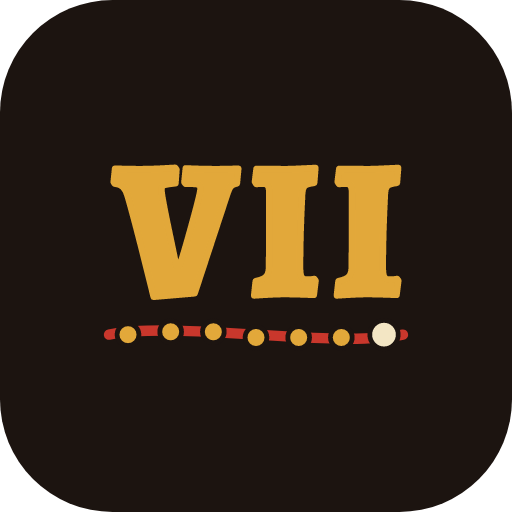
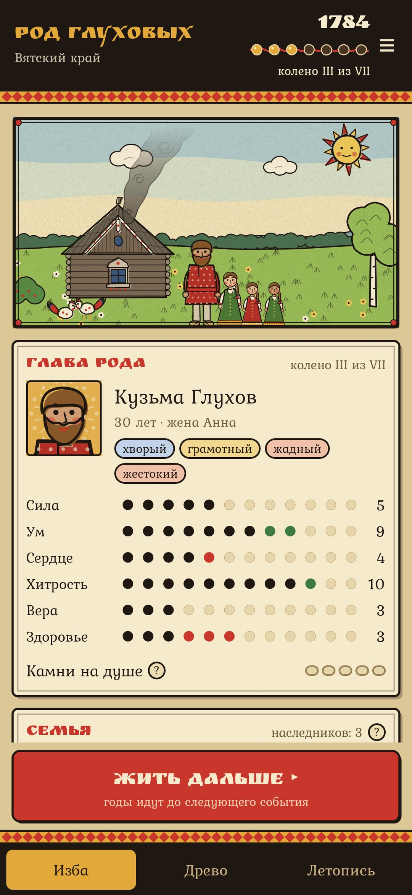
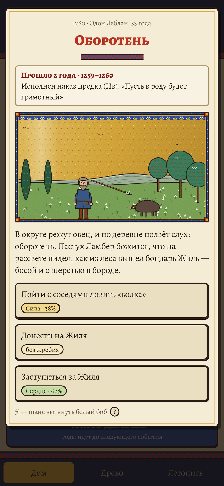
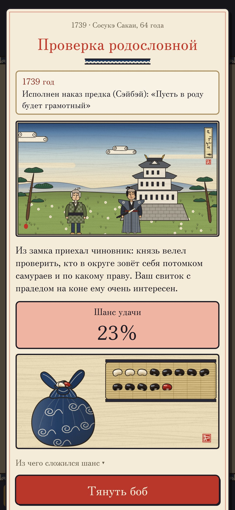
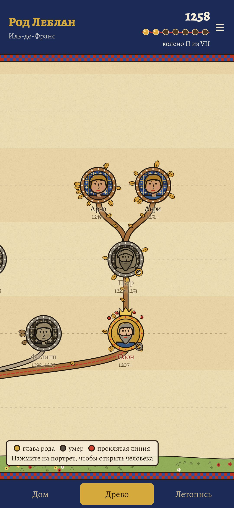
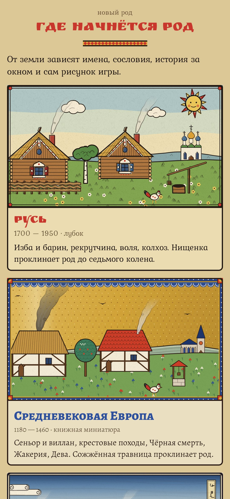

<div align="center">



# Седьмое колено

### Ваш род проклят до седьмого колена. Не дайте ему прерваться.

*Игра о роде, рассказанная как сказка. Основателя рода проклинают: на Руси — нищенка, которой не подали хлеба, во Франции — травница на костре, в Японии — белая лиса у святилища Инари. Год идёт за годом, и рано или поздно что-нибудь случается. Чем кончится рискованное дело, решает боб, который вы тянете из мешка: белый — удача, чёрный — беда, красный — проклятие. Дети наследуют кровь рода, а нрав у каждого свой. Когда глава рода умирает, вы выбираете, за кого из потомков играть дальше. Доживёт род до седьмого колена — проклятие спадёт. Умрёт последний в роду, не оставив детей, — род пресечётся. Бесплатно, без рекламы, без регистрации и без интернета.*

[English](README.md) · **Русский** · [Изменения](CHANGELOG.md)

    

</div>

---

## Как это устроено

1. **Выберите землю.** Русь, 1690–1950, в манере лубка. Средневековая Европа, 1180–1460, — книжная миниатюра. Япония, 1662–1950, — гравюра укиё-э. У каждой свои имена, сословия, соседи-враги, деньги, история и своё проклятие.
2. **Живите дальше.** Годы идут, пока что-нибудь не случится: медведь у околицы, пожар, сваха с тремя невестами, рекрутский набор, Чёрная смерть, шествие даймё, чёрные корабли. На каждой земле 75–84 повседневных события и 18–22 из настоящей истории.
3. **Тяните боб.** У каждого рискованного выбора виден шанс. Чем выше нужный показатель — сила, ум, сердце, хитрость, вера, здоровье, — тем больше в мешке белых бобов; черты, реликвии и наследие рода добавляют ещё. Пока держится проклятие, в мешке всегда лежит красный.
4. **Нрав и душа.** Дети вырастают добрыми или жестокими, храбрыми или трусливыми, честными или лживыми. Поступок против нрава кладёт камень на душу; пять камней — срыв.
5. **Последствия возвращаются.** Спрятанный беглый солдат приходит разбойником или благодетелем, украденное зерно всплывает на суде, подкидыш вырастает, долг приходит через годы. Род может уйти от сохи в торговлю, ремесло, цех или храм — и прожить другую жизнь.
6. **Наследие.** Когда глава умирает, играйте за любого живого потомка. Обойдёте старшего сына — затаит обиду. Умерший оставляет наказ: исполните — будет слава, забудете — он придёт во сне.
7. **Древо и летопись.** Весь род в медальонах, красная нить проклятой линии сквозь него, и каждый год записан.

Всё нарисовано кодом, у каждой земли свой стиль. Игра на русском и английском.

## Сборка

```
./gradlew testDebugUnitTest assembleDebug
./gradlew -Pdemo assembleDebug                                  # app.seventh.demo с родом уже в третьем колене
./gradlew testDebugUnitTest -Prender --tests '*Render*' --tests '*Screens*'   # картинки, иконка и все экраны в app/build/art
python tools/shots.py app/build/art/screens                     # скриншоты для README из рендеров
```

Правила — в `domain/Engine.kt`; каждая земля — пара файлов (`domain/Rus.kt` + `RusMore.kt`, `Europe.kt` + `EuropeMore.kt`, `Japan.kt` + `JapanMore.kt`) с именами, событиями и историей, каждая строка на двух языках. Все картинки рисуются кодом в `ui/art`.

Шрифты: Ruslan Display, Kurale, Alegreya и Alegreya SC, Zen Old Mincho (урезан до латиницы и кириллицы) — SIL Open Font License.

Часть [Stillcraft](https://bigdevwhale.github.io/stillcraft/) — набора тихих приложений без интернета.
